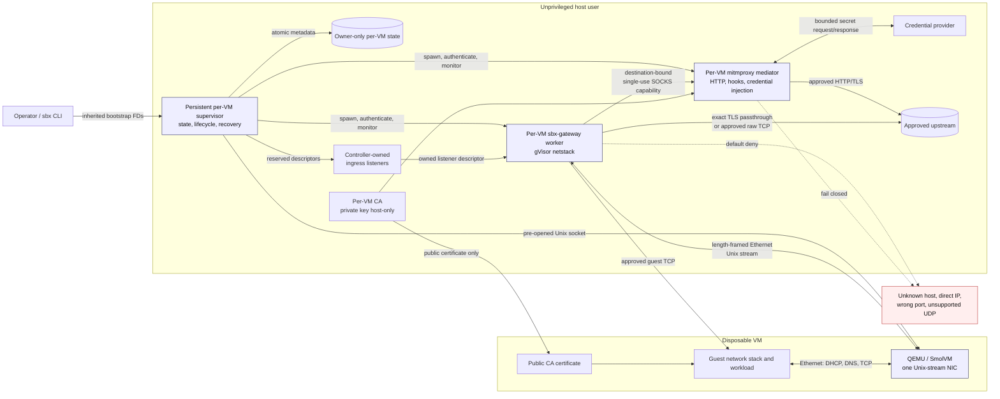

# Rootless network gateway operator smoke test

This runbook validates the gateway through the public `sbx` CLI as an operator would use it. It intentionally excludes unit tests, direct harnesses, artifact builds, and other checks that belong in the automated test suite.

Run it on Linux from the feature worktree root (`feature/rootless-network-gateway`), not the project organization root. Do not use real credentials.

## Architecture and data flow



The standalone Mermaid source is [`rootless-network-gateway-components.mmd`](rootless-network-gateway-components.mmd).

## 1. Prepare the smoke configuration

Confirm the feature worktree and required commands are available, then select the ignored local test directory:

```bash
test "$(git branch --show-current)" = feature/rootless-network-gateway
export ROOT=$PWD
export TEST_DIR="$ROOT/local"
mkdir -p "$TEST_DIR"
export UV_TOOL_DIR="$TEST_DIR/tool"
export UV_TOOL_BIN_DIR="$TEST_DIR/bin"
rm -rf "$TEST_DIR/dist" "$UV_TOOL_DIR" "$UV_TOOL_BIN_DIR"
uv build --wheel --out-dir "$TEST_DIR/dist"
WHEEL=$(find "$TEST_DIR/dist" -maxdepth 1 -name 'sbx-*.whl' -print -quit)
test -n "$WHEEL"
uv tool install --from "$WHEEL" sbx --python 3.12 --force
export PATH="$UV_TOOL_BIN_DIR:$PATH"
test "$(command -v sbx)" = "$UV_TOOL_BIN_DIR/sbx"
sbx --version
sbx network --help | grep -q diagnostics
mitmdump --version
qemu-system-x86_64 --version
rm -rf "$HOME/.smolvm/images/gateway-smoke-task31"
sbx image build --name gateway-smoke-task31
```

Create the smoke configuration from that fresh curated image.

```bash
cat >"$TEST_DIR/.sbx.toml" <<EOF
[sbx]
name = "gateway-smoke"
agent = "pi"
image = "~/.smolvm/images/gateway-smoke-task31"
run_user = "agent"
project_path = "$ROOT"
env = ["TEST_DIR"]

[network]
default = "deny"

[[network.policy]]
id = "example"
mode = "http-mediated"
hosts = ["example.com"]
ports = [443]
methods = ["GET", "HEAD"]

[[network.ingress]]
id = "dev-server"
listen = "127.0.0.1:13000"
guest_port = 3000
EOF
```

The egress smoke uses `example.com`; it requires host internet access. The policy deliberately allows only HTTPS GET/HEAD requests to that exact hostname. `project_path` makes the worktree, including `local/`, available at the same absolute path inside the guest, and the explicitly forwarded `TEST_DIR` points commands to it.

Run the cleanly installed command from `local/` so `sbx` discovers `.sbx.toml` automatically:

```bash
cd "$TEST_DIR"
```

## 2. Create the VM and inspect readiness

```bash
sbx create
sbx network status
sbx network diagnostics
```

**Pass:**

- the VM is running;
- the gateway reports ready rather than disabled, stale, or error;
- the ingress listener is bound to `127.0.0.1:13000`;
- no command asks for sudo, TAP/TUN, capabilities, or firewall changes;
- there is no warning about falling back to SLIRP.

If creation fails, stop here and preserve the diagnostics. Do not disable gateway mode to make the smoke test pass.

## 3. Verify allowed and denied egress

Open the guest shell:

```bash
sbx shell
```

Run these commands inside the guest:

```bash
set -eu

resolver=$(awk '$1 == "nameserver" { print $2 }' /etc/resolv.conf)
test "$resolver" = "192.0.2.1"
getent ahostsv4 example.com | awk '{ print $1 }' | grep -Eqm1 '^198\.(18|19)\.'
sudo /usr/local/bin/sbx-start-rootless-docker
test "$(awk '$1 == "nameserver" { print $2 }' /etc/resolv.conf)" = "192.0.2.1"

# A valid query sent directly to an alternate resolver must fail over UDP and TCP.
python3 - <<'PY'
import socket
import struct

name = b"\x07example\x03com\x00"
query = struct.pack("!HHHHHH", 1, 0x0100, 1, 0, 0, 0) + name + struct.pack("!HH", 1, 1)
for kind in (socket.SOCK_DGRAM, socket.SOCK_STREAM):
    try:
        with socket.socket(socket.AF_INET, kind) as sock:
            sock.settimeout(2)
            sock.connect(("1.1.1.1", 53))
            sock.sendall(query if kind == socket.SOCK_DGRAM else struct.pack("!H", len(query)) + query)
            if sock.recv(1):
                raise AssertionError(f"alternate DNS answered over socket type {kind}")
    except OSError:
        pass
PY

# Exact allowed HTTPS hostname and method: must succeed with certificate validation.
curl --max-time 15 -fsSI https://example.com/

must_fail() {
  if "$@"; then
    echo "FAIL: unexpectedly allowed: $*" >&2
    return 1
  fi
  echo "PASS: denied: $*"
}

# A sibling hostname is not covered by the exact rule.
must_fail curl --max-time 10 -fsSI https://www.example.com/

# Direct-IP egress remains denied even when TLS verification is disabled.
must_fail curl --max-time 10 -kfsSI https://1.1.1.1/

# Port 80 and HTTP downgrade are not covered by the port-443 rule.
must_fail curl --max-time 10 -fsSI http://example.com/

# POST is not one of the allowed methods.
must_fail curl --max-time 10 -fsS -X POST https://example.com/
```

**Pass:** the resolver list contains only `192.0.2.1` before and after the Docker helper, `example.com` receives a synthetic `198.18.0.0/15` address, alternate UDP/TCP DNS fails, the allowed request succeeds, and all four negative requests print `PASS: denied`. Successful certificate validation also exercises the guest's public CA installation and mediated TLS path. Do not edit `/etc/resolv.conf`.

## 4. Verify host-to-guest ingress

Keep the guest shell open and start a guest service:

```bash
mkdir -p "$TEST_DIR/sbx-ingress-smoke"
printf 'gateway ingress works\n' >"$TEST_DIR/sbx-ingress-smoke/index.html"
python3 -m http.server 3000 --bind 0.0.0.0 --directory "$TEST_DIR/sbx-ingress-smoke"
```

From a second host terminal:

```bash
export ROOT=/home/nueces/code/sbx/feature/rootless-network-gateway
export TEST_DIR="$ROOT/local"
export UV_TOOL_BIN_DIR="$TEST_DIR/bin"
export PATH="$UV_TOOL_BIN_DIR:$PATH"
cd "$TEST_DIR"
sbx network status >/dev/null
test "$(curl -fsS http://127.0.0.1:13000/)" = "gateway ingress works"
```

**Pass:** the host request reaches the guest service through the configured loopback listener. Stop the guest HTTP server with Ctrl-C after this check.

## 5. Verify stop and restart behavior

From the host:

```bash
sbx stop
! curl -fsS --max-time 2 http://127.0.0.1:13000/
sbx network diagnostics
```

**Pass:** stopping the VM closes ingress, and diagnostics do not report a live gateway.

Start the same VM again without recreating it:

```bash
sbx create
sbx network status
sbx network diagnostics
```

Enter the guest and repeat the exact allowed request:

```bash
sbx shell
test "$(awk '$1 == "nameserver" { print $2 }' /etc/resolv.conf)" = "192.0.2.1"
getent ahostsv4 example.com | awk '{ print $1 }' | grep -Eqm1 '^198\.(18|19)\.'
curl --max-time 15 -fsSI https://example.com/
exit
```

**Pass:** the existing VM starts with a newly ready gateway and allowed egress works again. There is no unrestricted fallback during the stopped interval or restart.

## 6. Clean up

```bash
sbx stop
sbx rm --force
! curl -fsS --max-time 2 http://127.0.0.1:13000/
rm -rf "$TEST_DIR/sbx-ingress-smoke"
rm -f "$TEST_DIR/.sbx.toml"
rm -rf "$TEST_DIR/tool" "$TEST_DIR/bin" "$TEST_DIR/dist"
rm -rf "$HOME/.smolvm/images/gateway-smoke-task31"
```

**Pass:** the VM is removed and the ingress port remains closed.

## Operator record

Record the following in the PR or release notes:

- commit hash;
- Linux and QEMU versions;
- curated image path;
- create, status, and diagnostics output;
- allowed/denied egress results;
- ingress response;
- stop, restart, and cleanup results;
- confirmation that no real credentials were used;
- `macOS runtime: unverified` unless separately tested on macOS.
